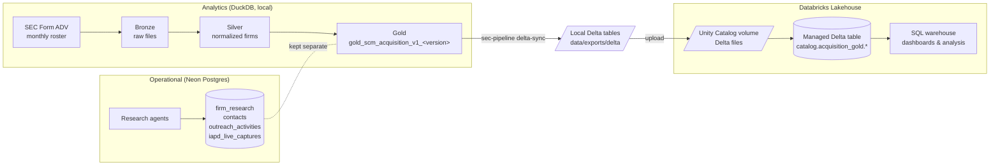
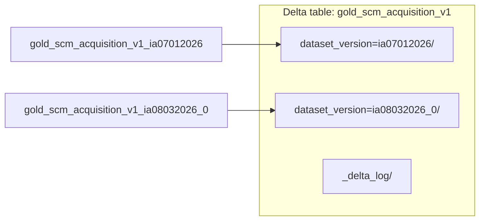
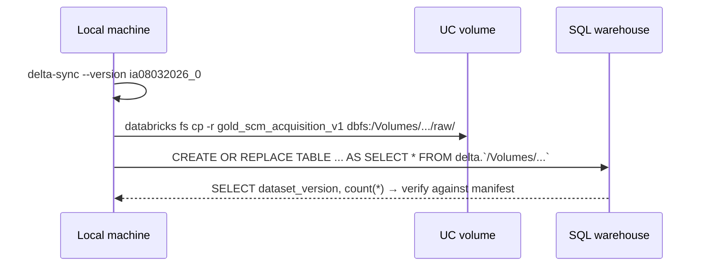

# Databricks Delta Sync

The analytics pipeline runs locally on DuckDB. `delta-sync` copies its finished **gold** tables into
**Delta Lake** tables that Databricks can register in **Unity Catalog**. Operational state (agent
research, contacts, outreach) stays in **Neon Postgres** and is never part of this export.

## Where it fits



## How one gold table becomes one Delta table

DuckDB stores one table per monthly dataset version. `delta-sync` folds every version into a single
Delta table, partitioned by `dataset_version`.



- **Table names** are parsed as `gold_<name>_<dataset_version>`; `<name>` becomes the Delta table name.
- **Re-runs are safe.** Each run overwrites only the partitions for the versions it syncs
  (`predicate = dataset_version = '<version>'`); other versions are left alone.
- **Schema drift is merged** (`schema_mode="merge"`), so a newly added gold column doesn't fail the write.
- **An existing `dataset_version` column is reused** and set from the table name, never duplicated.
- **Writes nothing to Databricks itself.** The job prints `CREATE TABLE` statements and writes a
  `_sync_manifest.json` with row counts per table and version.

## Usage

Install the optional dependency:

```bash
pip install -e '.[delta]'
```

Preview what would be exported (reads DuckDB, writes nothing):

```bash
SCM_ENV=PROD python3 -m src.cli delta-sync --dry-run --catalog workspace
```

Export one version to a local folder:

```bash
SCM_ENV=PROD python3 -m src.cli delta-sync --version ia08032026_0 --catalog workspace
```

Write straight to cloud storage that Databricks can read (credentials come from the environment,
e.g. `AWS_PROFILE` / `AWS_REGION`):

```bash
SCM_ENV=PROD python3 -m src.cli delta-sync --target s3://<bucket>/acquisition_gold
```

| Option | Default | Meaning |
|---|---|---|
| `--target` | `<data>/exports/delta` | Local folder or `s3://`, `abfss://`, `gs://` URI |
| `--version` | all versions | Dataset version to sync; repeat for several |
| `--catalog` | `main` | Unity Catalog catalog used in the printed DDL |
| `--schema` | `acquisition_gold` | Schema used in the printed DDL |
| `--dry-run` | off | Count rows and print DDL without writing |

## Loading into Unity Catalog



```bash
databricks schemas create acquisition_gold workspace
databricks volumes create workspace acquisition_gold raw MANAGED
databricks fs cp -r data/exports/delta/gold_scm_acquisition_v1 \
  dbfs:/Volumes/workspace/acquisition_gold/raw/gold_scm_acquisition_v1
```

```sql
CREATE OR REPLACE TABLE workspace.acquisition_gold.gold_scm_acquisition_v1
AS SELECT * FROM delta.`/Volumes/workspace/acquisition_gold/raw/gold_scm_acquisition_v1`;

SELECT dataset_version, count(*) FROM workspace.acquisition_gold.gold_scm_acquisition_v1 GROUP BY 1;
```

Unity Catalog does not allow an external table whose location is inside a volume, so the volume is a
landing zone and the table is a managed copy. The `CREATE TABLE ... LOCATION` statements the job prints
are for cloud-storage targets, not local folders.

**First load (Oct 2026):** `ia08032026_0`, 17,018 rows, row count matched DuckDB.

## Tests

```bash
python3 -m pytest tests/test_delta_sync.py
```

Covers table-name parsing, writing two versions into one partitioned table, idempotent re-runs, an
existing `dataset_version` column, and the manifest.
