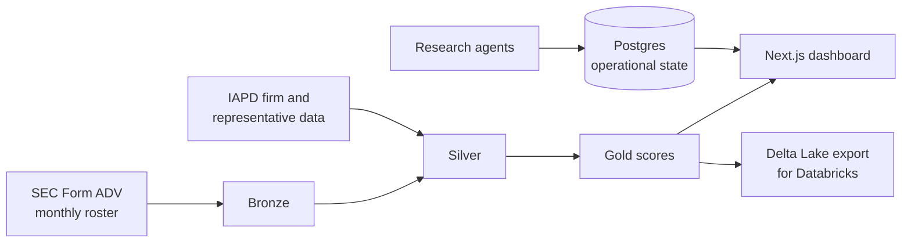

# Acquisition Intelligence Platform

Finds and ranks registered investment advisers (RIAs) as acquisition targets, using public SEC Form ADV
and IAPD data. The code lives in [`AcquisitionDatabaseApp/`](AcquisitionDatabaseApp/).



| Part | Where | Stack |
|---|---|---|
| Ingestion and scoring pipeline (bronze → silver → gold) | `AcquisitionDatabaseApp/src/` | Python, DuckDB |
| Operational state: research, contacts, outreach | `AcquisitionDatabaseApp/web/drizzle/` | Postgres (Neon) |
| Dashboard | `AcquisitionDatabaseApp/web/` | Next.js, Drizzle |
| Tests | `AcquisitionDatabaseApp/tests/` | pytest |

## Quick start

```bash
cd AcquisitionDatabaseApp
python3 -m venv .venv && source .venv/bin/activate
pip install -e .
pip install pytest
SCM_ENV=TEST pytest -q
python -m src.cli --help
```

Dashboard:

```bash
cd AcquisitionDatabaseApp/web
npm ci
npm run build
```

A local Postgres for the dashboard is defined in `AcquisitionDatabaseApp/docker-compose.yml`.

## Data

Generated data (DuckDB files, downloaded SEC files, gold outputs, profiling reports) is produced by the
pipeline and is not committed. `SCM_ENV` chooses the data folder (`data-dev/`, `data-test/`, or `data/`
for production).

## Archive

[`archive/`](archive/) holds earlier prototypes and retired modules, kept for reference. Nothing in the
build uses them.
